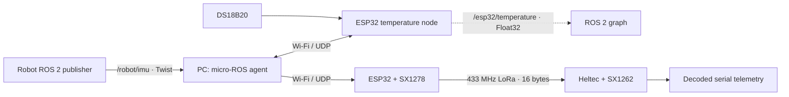

# ESP32 ROS 2 Telemetry over Wi-Fi and LoRa

Embedded sensor integration with **ROS 2 Humble**, **micro-ROS**, and **ESP32**. An ESP32 publishes DS18B20 temperature readings and subscribes to robot telemetry over Wi-Fi. A second ESP32 forwards robot telemetry through an SX1278 LoRa radio to a Heltec receiver, extending the system with a compact wireless telemetry link.

**Stack:** Arduino C++ · ESP32 · ROS 2 Humble · micro-ROS · DS18B20 · SX1278 · SX1262

[Firmware](firmware/) · [Setup and wiring](docs/setup.md) · [Packet format](docs/packet-format.md) · [Implementation notes](docs/implementation-notes.md)

## What the project does

- Publishes temperature as `/esp32/temperature` using `std_msgs/msg/Float32`.
- Subscribes to `/robot/imu` using `geometry_msgs/msg/Twist` through a micro-ROS agent.
- Packs six telemetry values into a **16-byte radio frame**, with a sequence number and CRC-8.
- Receives and validates the frame on a separate Heltec device, then prints decoded values to serial.

The core integration demonstrates ROS topic publishing and subscribing directly from microcontrollers. The LoRa extension adds a one-way radio hop from the Wi-Fi-connected transmitter to a separate serial receiver.

## System architecture



The temperature topic reaches the ROS graph through the agent. The Heltec receiver is a serial telemetry endpoint; it does not republish received packets into ROS 2.

## Firmware

| Sketch | Hardware | Function |
| --- | --- | --- |
| [temperature_node](firmware/temperature_node/temperature_node.ino) | ESP32 and DS18B20 | Periodic temperature publication and robot IMU-topic subscription |
| [sx1278_imu_transmitter](firmware/sx1278_imu_transmitter/sx1278_imu_transmitter.ino) | ESP32 and SX1278 | Subscribe to robot telemetry, quantize values, build binary frames, and transmit over LoRa |
| [heltec_imu_receiver](firmware/heltec_imu_receiver/heltec_imu_receiver.ino) | Compatible Heltec ESP32-S3/SX1262 board | Check payload length, header, and CRC; decode values and print them to serial |

Each folder is a separate Arduino sketch. The SX1278 transmitter and Heltec receiver use different radio libraries; select the matching board and library for each device.

## Demonstrated behavior

The project demonstrated ESP32 temperature publication and robot-topic subscription using micro-ROS over Wi-Fi, with ROS graph, topic echo, and serial output used to inspect the data. The LoRa extension forwards packed robot telemetry to a separate receiver for serial inspection.

The transmitter limits its send schedule to one frame per 100 ms. This is a firmware setting, rather than a measured delivery-rate or range guarantee. See the [implementation notes](docs/implementation-notes.md) for sampling, freshness, and numeric-range details.

## Getting started

1. Install the appropriate ESP32/Heltec board support and the libraries listed in the [setup guide](docs/setup.md).
2. Create local configuration files for the two Wi-Fi sketches:

   ```bash
   cp firmware/temperature_node/secrets.example.h firmware/temperature_node/secrets.h
   cp firmware/sx1278_imu_transmitter/secrets.example.h firmware/sx1278_imu_transmitter/secrets.h
   ```

3. Set your Wi-Fi credentials and the micro-ROS agent's IP address in those local files.
4. Run the Humble micro-ROS agent on your ROS computer, matching the firmware's domain and UDP port:

   ```bash
   export ROS_DOMAIN_ID=10
   ros2 run micro_ros_agent micro_ros_agent udp4 --port 8888
   ```

5. Open each `.ino` in Arduino IDE, select its board, and upload it to the corresponding device. If both micro-ROS clients are used together, give each its own agent process and UDP port as described in the [setup guide](docs/setup.md#running-both-wi-fi-nodes).

Both micro-ROS sketches use domain **10**. Their local port configuration must match their respective agent process. The receiver needs no Wi-Fi credentials.

## Telemetry convention

The robot exposes IMU-related values through `Twist` fields:

| Field | Meaning in this project |
| --- | --- |
| `linear.x`, `linear.y`, `linear.z` | Unused by the reported robot publisher; still included in the packet |
| `angular.x` | Z-axis angular rate |
| `angular.y` | Estimated Z-axis bias |
| `angular.z` | Integrated yaw in degrees |

These are project-specific meanings, rather than the standard velocity interpretation of `Twist`. Scaling every field by 1000 before storing it in `int16_t` limits the representable range to **−32.768 through +32.767** in the field's original units. Yaw outside that range is clipped. The [packet specification](docs/packet-format.md) describes the exact encoding.

## Source and validation

The three implementations were recovered from the author's working project code. Publication preparation restored line wrapping from the source document and moved network configuration into ignored local headers. The firmware behavior and radio settings are retained.

Run the host packet checks with Python 3 and `g++`:

```bash
python3 tools/validate_packet.py
```

These checks exercise the packet structures, quantization, and CRC extracted from the actual sketches. They do not compile the complete Arduino firmware or replace device testing. Exact board-package and library versions from the original hardware setup were not recorded.

## Author and dependencies

Developed by **[Adhithya Palanisamy Chandrasekaran](https://github.com/ADHU-ADHU)**, with a focus on embedded systems, mechatronics, and robotics communication.

- [micro-ROS Arduino, Humble](https://github.com/micro-ROS/micro_ros_arduino/tree/humble)
- [Arduino-LoRa for SX127x radios](https://github.com/sandeepmistry/arduino-LoRa)
- [Heltec ESP32 board and library setup](https://docs.heltec.org/en/node/esp32/esp32_general_docs/quick_start.html)
- [DallasTemperature](https://github.com/milesburton/Arduino-Temperature-Control-Library) and [OneWire](https://github.com/PaulStoffregen/OneWire)

Upstream libraries retain their respective licenses.
