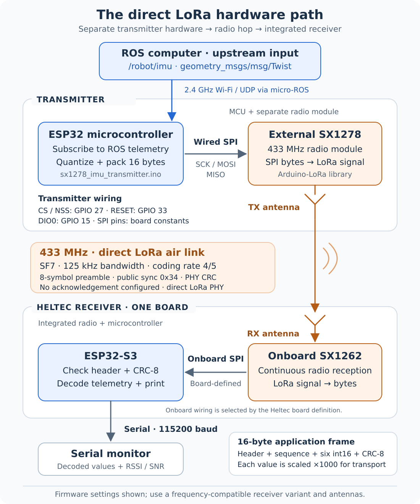

# Direct LoRa communication: ESP32 + SX1278 to Heltec

The **SX1278 and SX1262 communicate directly over the air**. Each radio is controlled by a microcontroller at its own end. The transmitter uses a separate ESP32 and an external SX1278 breakout; the Heltec receiver integrates its ESP32-S3 and SX1262 radio on the same PCB.

## Where the PC fits

There are two successive communication links in this project:

1. **Robot / ROS graph → micro-ROS agent on the PC → transmitter ESP32, over Wi-Fi / UDP.** This provides the `/robot/imu` values that the transmitter will encode.
2. **Transmitter ESP32 → wired SX1278 → LoRa air link → onboard SX1262 → Heltec ESP32-S3.** This delivers the encoded telemetry to the receiver.

The PC is the ROS-to-micro-ROS bridge on the input side. It is not a relay between the two radios. The Heltec receiver needs no Wi-Fi connection, micro-ROS agent, or LoRaWAN gateway to receive these packets. A computer connected to the receiver's USB port simply displays serial output; that computer may be the same PC, but the USB connection does not carry the over-the-air hop.

Fresh robot telemetry depends on the transmitter receiving ROS updates over Wi-Fi. The sketch requires a reachable agent during startup and waits for its first robot message before sending LoRa packets. After that, its send loop can repeat the last stored sample. Repeated radio reception therefore does not by itself prove that the upstream robot data is still fresh.

## Transmitter hardware: ESP32 with an external radio

The ESP32 runs micro-ROS, stores the most recent `Twist`, and builds a binary payload. Its own Wi-Fi radio does not generate the LoRa signal: the attached **SX1278** performs that job.

| Connection | Firmware selection | Role |
| --- | --- | --- |
| SPI clock | Board's `SCK` constant | ESP32 clocks transfers to and from the radio |
| SPI MOSI | Board's `MOSI` constant | ESP32 writes radio registers and packet bytes |
| SPI MISO | Board's `MISO` constant | ESP32 reads radio registers and status |
| NSS / CS | GPIO27 | Selects the external radio for an SPI transaction |
| RESET | GPIO33 | Resets the radio during initialization |
| DIO0 | GPIO15 | Configured radio event pin; this sketch uses blocking sends without a transmit-done callback |
| Power and ground | Supply appropriate to the module; shared ground | Electrical connection between the ESP32 and external module |
| RF antenna | Matched to the radio board and operating band | Converts the radio's RF output to a transmitted signal |

SCK, MOSI, and MISO are **wired SPI signals**, not wireless links. Their numeric GPIO assignments come from the selected Arduino board definition. The existing [setup guide](setup.md#hardware-roles) records the project's wiring choices.

### What happens for each send

1. `imu_callback()` copies a newly received ROS message into `imu_latest`.
2. Once the first message has arrived, the loop allows a send attempt when at least **100 ms** has elapsed since the previous attempt. There is no queue of every robot sample: the payload uses the latest stored values.
3. `send_imu_lora()` scales all six fields by 1000, clamps them to the signed 16-bit range, and adds an application header, sequence counter, and CRC-8.
4. `LoRa.beginPacket()` starts a packet and `LoRa.write()` transfers the **16 payload bytes** into the SX1278 through SPI.
5. `LoRa.endPacket()` starts the radio transmission and waits for local transmission completion. The SX1278 handles LoRa modulation and RF transmission through its antenna.

The Arduino-LoRa library drives the SX1278; it does not run on the remote Heltec. Its blocking send API is documented in the [upstream library reference](https://github.com/sandeepmistry/arduino-LoRa/blob/master/API.md#end-packet). See the [actual transmitter sketch](../firmware/sx1278_imu_transmitter/sx1278_imu_transmitter.ino).

## Over the air: the common LoRa configuration

The physical radio hop is **antenna → air → antenna**. The packet contains the project's compact binary telemetry, rather than a ROS message transported directly over LoRa.

| Setting | SX1278 transmitter | Heltec SX1262 receiver |
| --- | --- | --- |
| Carrier frequency | `LoRa.begin(433E6)` | `Radio.SetChannel(433000000)` |
| Spreading factor | `7` | `7` |
| Bandwidth | `125E3` Hz | `0`, the driver code for 125 kHz |
| Coding rate | `LoRa.setCodingRate4(5)`, meaning 4/5 | `1`, the driver code for 4/5 |
| Preamble | 8 symbols | 8 symbols |
| Header mode | Explicit / variable-length | Variable-length |
| Radio PHY CRC | Enabled | Enabled |
| Network sync | Public sync word `0x34` | `Radio.SetPublicNetwork(true)` |
| IQ inversion | Normal, library default | `false` |

The two software APIs express some settings differently, so matching numbers alone is not the rule: the resulting radio settings must agree. Both ends must also have an RF front end and antenna that support the chosen carrier. The [hardware guide](hardware.md#receiver-variant-and-radio-band) explains why the exact Heltec band variant remains unconfirmed by the source material.

The radio sync word and the application byte `0xAA` have different roles. The radio sync is part of LoRa reception; `0xAA` is the first byte of the project's payload and is checked later by the receiver application. Selecting public sync does not introduce a LoRaWAN server or join procedure.

## Receiver hardware: the LoRa radio is already onboard

The Heltec board family identified by the project integrates an **ESP32-S3 MCU and SX1262 LoRa transceiver**. They are two chips on one board. The SX1262 is the radio; the ESP32-S3 executes the application. The board still needs a suitable LoRa antenna.

The onboard radio is connected through the PCB's SPI and control wiring. The selected Heltec board definition and driver manage those connections, so this receiver sketch does not reproduce the transmitter's external wiring or pin numbers. An external SX1278 breakout is unnecessary on this side. See [Heltec's product documentation](https://heltec.org/project/wireless-stick-lite-v2/) for the integrated board family and the [hardware guide](hardware.md#heltec-receiver) for the variant distinction.

### What happens for each received packet

1. `Mcu.begin(HELTEC_BOARD, ...)` initializes the selected Heltec board. `Radio.Init()` registers the receive callback, and the sketch sets the carrier and receive configuration.
2. `Radio.Rx(0)` starts reception. `Radio.IrqProcess()` services radio events in the main loop.
3. The SX1262 receives and demodulates the radio signal. A completed reception reaches the application through `OnRxDone(payload, size, rssi, snr)`.
4. The callback prints packet diagnostics and requires exactly **16 bytes**, application sync `0xAA`, type `0x01`, and a matching **CRC-8 over bytes 0–14**. A failed application check prevents decoding the packet as valid telemetry.
5. It divides the six integer fields by `1000.0f` and prints the decoded values, sequence number, and radio diagnostics to serial at **115200 baud**.
6. It marks the receiver ready so the loop can enter reception again.

The Heltec library's `LoRaWan_APP.h` header supplies the radio API used here. The application implements a direct LoRa receiver. See the [actual receiver sketch](../firmware/heltec_imu_receiver/heltec_imu_receiver.ino).

## What reception does and does not confirm

- **Local `TX OK`:** the transmit function returned success. There is no receiver acknowledgement in this firmware.
- **Receiver `IMU OK`:** a received payload passed the application's size, header, and CRC checks and was decoded. It does not establish sample age because there is no timestamp.
- **Sequence number:** increments for each send attempt and wraps after 255. It can change even when the robot values repeat; the receiver prints it without calculating loss statistics.
- **Two CRC layers:** the radio PHY CRC and application CRC-8 provide error detection at different stages. Neither is encryption or sender authentication.
- **Direction:** these radio chips are transceivers, but this implementation uses the SX1278 to send and the Heltec to receive. No return telemetry, ACK, automatic retransmission protocol, or ROS republishing is implemented.

For field offsets, numeric limits, byte order, and the CRC definition, see the [packet format](packet-format.md). The [overall system architecture](../README.md#system-architecture) includes the separate Wi-Fi temperature branch.
